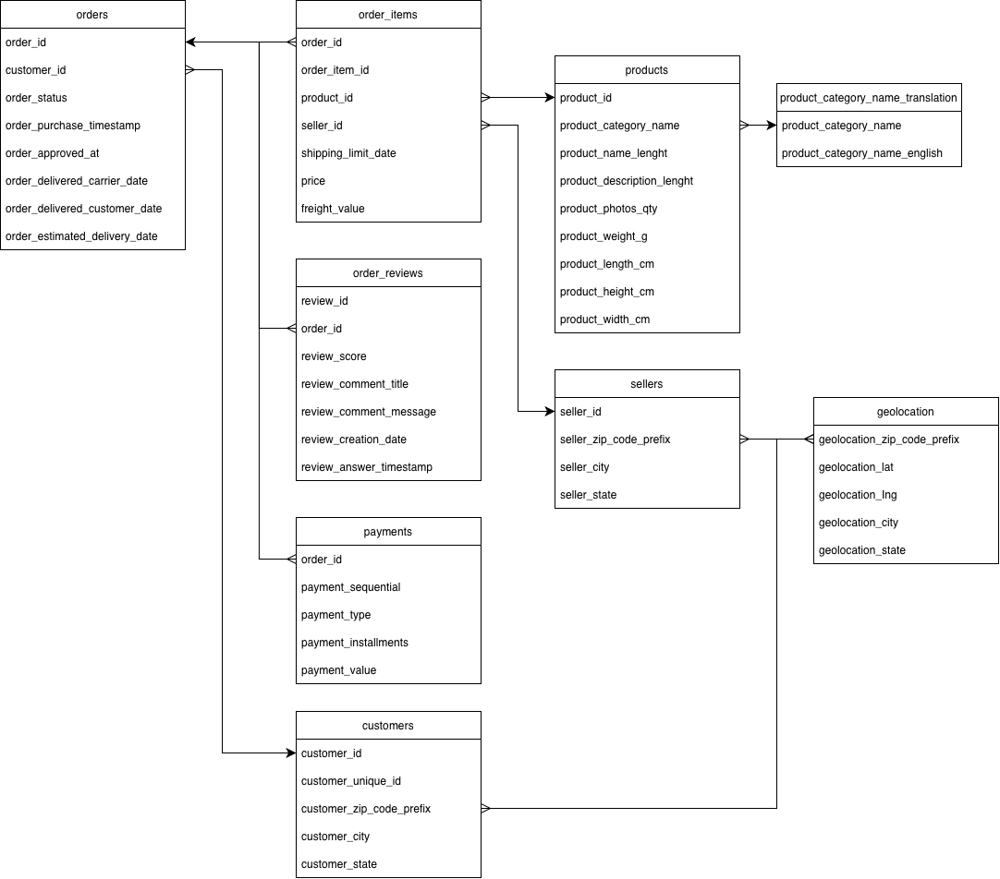
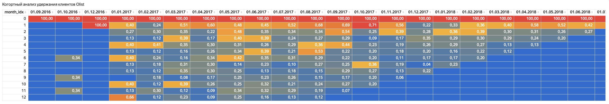
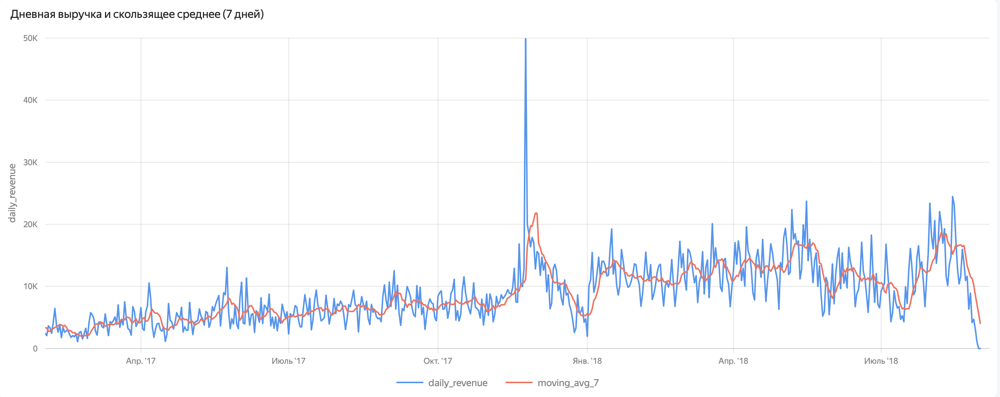
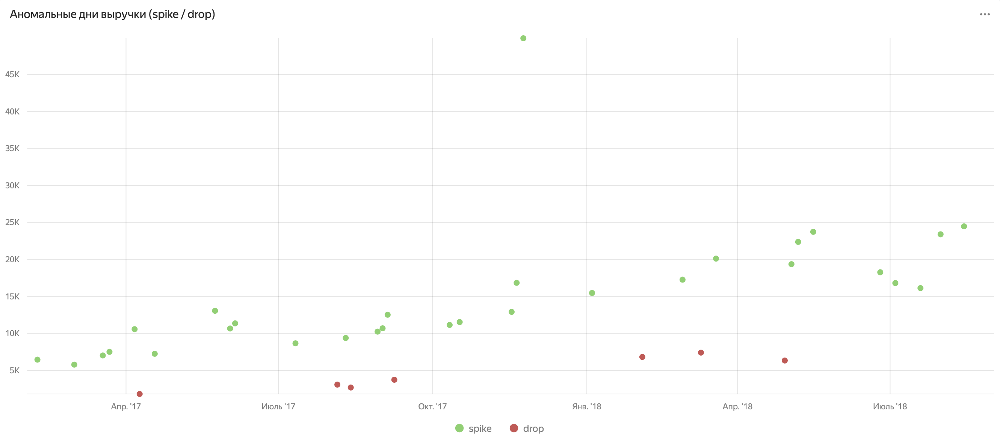
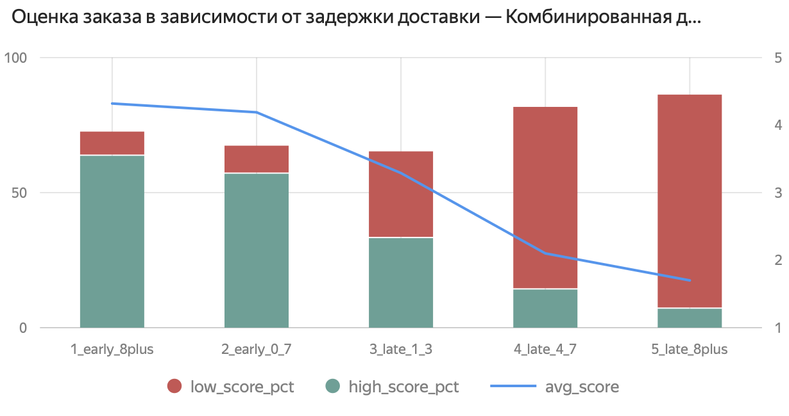
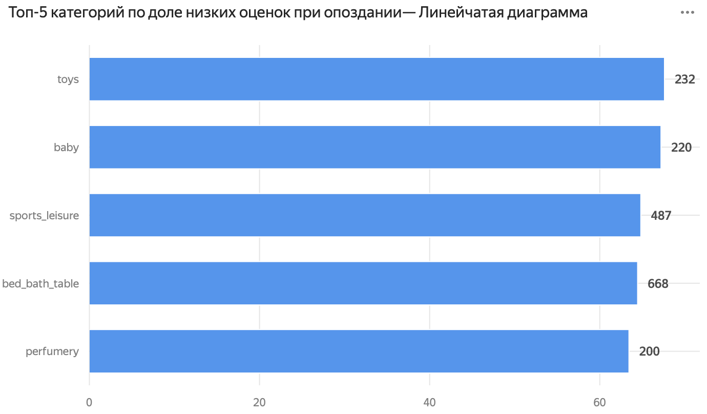
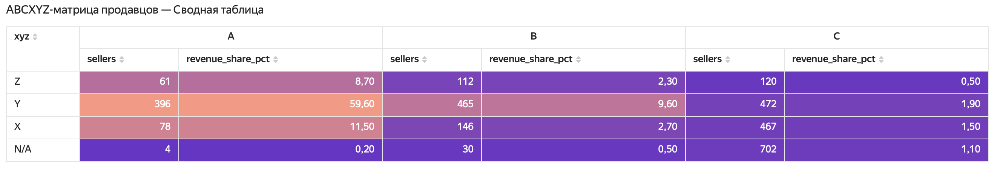
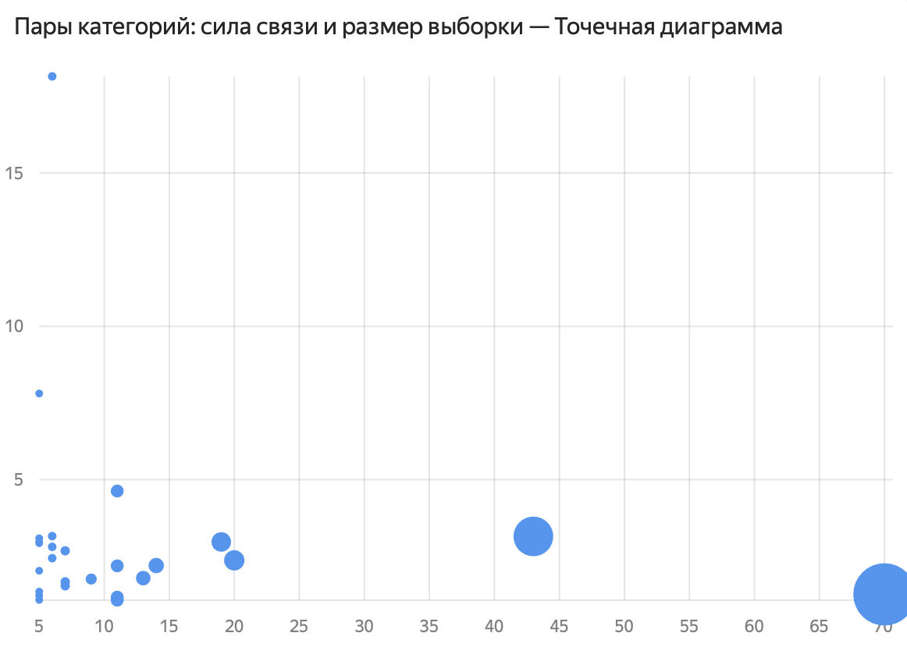
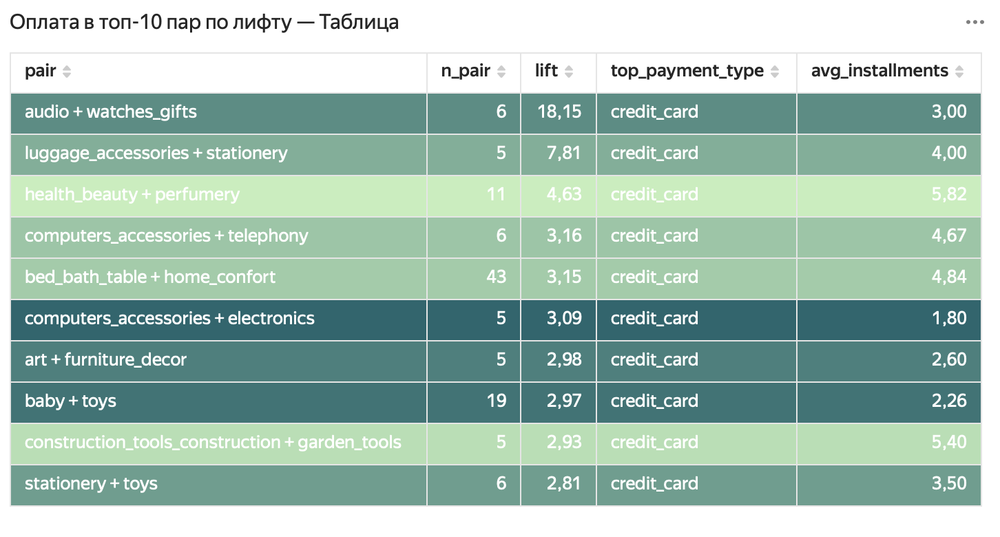

# Анализ маркетплейса Olist на SQL

Учебный проект по анализу данных бразильского маркетплейса Olist: пять аналитических задач на PostgreSQL и интерактивный дашборд в Yandex DataLens.

**Дашборд:** [открыть в DataLens](https://datalens.yandex/192tun2ea520k?_share_link=public)

**Инструменты:** PostgreSQL, pgAdmin, Yandex DataLens

**Данные:** [Brazilian E-Commerce Public Dataset by Olist](https://www.kaggle.com/datasets/olistbr/brazilian-ecommerce) — около 100 тыс. заказов за 2016–2018 годы.

---

## Структура репозитория

```
├── README.md
├── sql/        — SQL-запросы по каждой задаче
├── results/    — результаты запросов в CSV
└── images/     — ER-диаграмма и скриншоты дашборда
```

## Схема данных



Основные таблицы: `orders`, `order_items`, `customers`, `sellers`, `products`, `order_reviews`, `payments`, `product_category_name_translation`.

Во всех задачах исключены заказы со статусами `canceled` и `unavailable`.

---

## 1. Когортный анализ удержания клиентов

**Вопрос:** какая доля клиентов возвращается за повторной покупкой в течение года после первого заказа?

**Подход:** клиент определяется по `customer_unique_id`, когорта — календарный месяц первого заказа. Для каждой когорты считается доля клиентов, сделавших заказ через 1, 2, …, 12 месяцев.

**Выводы:**
- Удержание очень низкое: в большинстве когорт в любой месяц возвращается менее [X]% клиентов. Основная часть покупателей совершает один заказ.
- Когорты 2016 года и конца 2018 года малочисленны, их значения шумные.

📄 [SQL](sql/cohort_retention.sql)



---

## 2. Аномалии дневной выручки

**Вопрос:** в какие дни выручка резко отклонялась от обычного уровня?

**Подход:** для каждого дня считается скользящее среднее выручки за предыдущие 7 дней и стандартное отклонение за предыдущие 30 дней (текущий день в окно не входит). Аномалия — отклонение больше 2 стандартных отклонений. Дни без заказов заполнены нулями через `generate_series`. Анализ сделан по каждому штату и по Бразилии в целом.

**Выводы:**
- Самый сильный всплеск — 24.11.2017 (Black Friday): в штате SP дневная выручка достигла около 60 тыс. BRL при обычном уровне [X] BRL.
- В малых штатах (RR, AC, AP) заказов мало, поэтому аномалий много и они малоинформативны; показательнее крупные штаты — SP, RJ, MG.

📄 [SQL](sql/revenue_anomalies.sql)




---

## 3. Влияние задержки доставки на оценку

**Вопрос:** как опоздание доставки связано с оценкой заказа и в каких категориях опоздания вредят сильнее всего?

**Подход:** задержка = дата фактической доставки − обещанная дата (в днях). Заказы разбиты на 5 групп: от «раньше срока более чем на 7 дней» до «опоздание более 7 дней». На заказ берётся один последний отзыв. Для категорий учтены только категории со 100+ опоздавшими заказами.

**Выводы:**
- Связь задержки и оценки отрицательная и нелинейная: при доставке в срок средняя оценка около [X], при опоздании более чем на неделю — около [Y].
- Доля оценок 1–2 растёт с [X]% у вовремя доставленных заказов до [Y]% при опоздании более недели.
- Ранняя доставка почти не повышает оценку по сравнению с доставкой в срок: клиенту важно получить заказ не позже обещанного.
- Категории с наибольшей долей низких оценок при опоздании: [перечисли топ-5].

📄 [SQL](sql/delivery_and_score.sql)




---

## 4. ABC/XYZ-анализ продавцов

**Вопрос:** какие продавцы приносят основную выручку и насколько стабильны их продажи?

**Подход:**
- ABC — по накопленной доле выручки: A — первые 80%, B — следующие 15%, C — последние 5%.
- XYZ — по коэффициенту вариации месячной выручки (std / mean): X < 0,5, Y 0,5–1, Z > 1. Продавцы с продажами только в одном месяце выделены в отдельную группу N/A.

**Выводы:**
- [X]% продавцов (класс A) дают 80% выручки.
- Большинство продавцов класса C — разовые или нестабильные (Z и N/A).
- [Дополни выводом по матрице: например, сколько продавцов в AX — ключевых и стабильных.]

📄 [SQL](sql/abc_xyz.sql)



---

## 5. Анализ корзины: какие категории покупают вместе

**Вопрос:** какие категории товаров покупают в одном заказе чаще, чем случайно, и как такие заказы оплачивают?

**Подход:** self-join таблицы «заказ — категория» по `order_id`, расчёт support, confidence и lift. Для топ-10 пар по lift — самый частый способ оплаты и среднее число рассрочек (по основному платежу заказа).

**Выводы:**
- Только около 1% заказов содержат товары из 2+ категорий (около 725 заказов). Среди всех заказов lift почти всех пар меньше 1, поэтому метрики посчитаны внутри мультикатегорийных заказов.
- Самая устойчивая связь: `bed_bath_table + home_confort` — 43 заказа, lift 3,15; в 86% таких заказов с `home_confort` есть и `bed_bath_table`.
- Самая частая пара `bed_bath_table + furniture_decor` (70 заказов) имеет lift всего 1,26 — это эффект популярности категорий, а не особая связь.
- Устойчивые тематические связки: `baby + toys`, `baby + cool_stuff`, `health_beauty + perfumery`.
- Пары с максимальным lift (`audio + watches_gifts`, lift 18) основаны на 5–6 заказах и статистически ненадёжны.
- Основной способ оплаты во всех топ-10 парах — кредитная карта; среднее число рассрочек от 1,8 до 5,8.

📄 [SQL](sql/products_pairs.sql)




---

## Подводные камни, которые пришлось учесть

- **Задвоение метрик.** В заказе может быть несколько товаров и несколько отзывов: при джойнах оценки и заказы размножаются. Решение — один последний отзыв на заказ (`ROW_NUMBER`) и `DISTINCT` по паре «заказ — категория».
- **Даты против таймстемпов.** Обещанная дата доставки хранится как полночь, поэтому сравнение таймстемпов относило доставленные в срок заказы к опоздавшим. Задержка считается по датам.
- **Календарные месяцы в когортах.** Разница через `AGE` даёт прошедшие месяцы, а не календарные, и смещает повторные покупки в нулевой месяц.
- **Пропущенные дни.** Без заполнения нулями окно «7 строк» превращается в «7 дней с продажами», что искажает скользящее среднее.
- **Несколько платежей на заказ.** Для способа оплаты и рассрочки берётся основной платёж (с наибольшей суммой).
- **Неподходящая метрика.** Из-за редкости мультикатегорийных заказов lift на всех заказах почти всегда < 1; постановка скорректирована.

## Ограничения

- Данные за 2016 год и конец 2018 года неполные.
- В малых штатах и малых когортах значения шумные.
- В анализе корзины выборки по парам маленькие (5–70 заказов), выводы ориентировочные.
