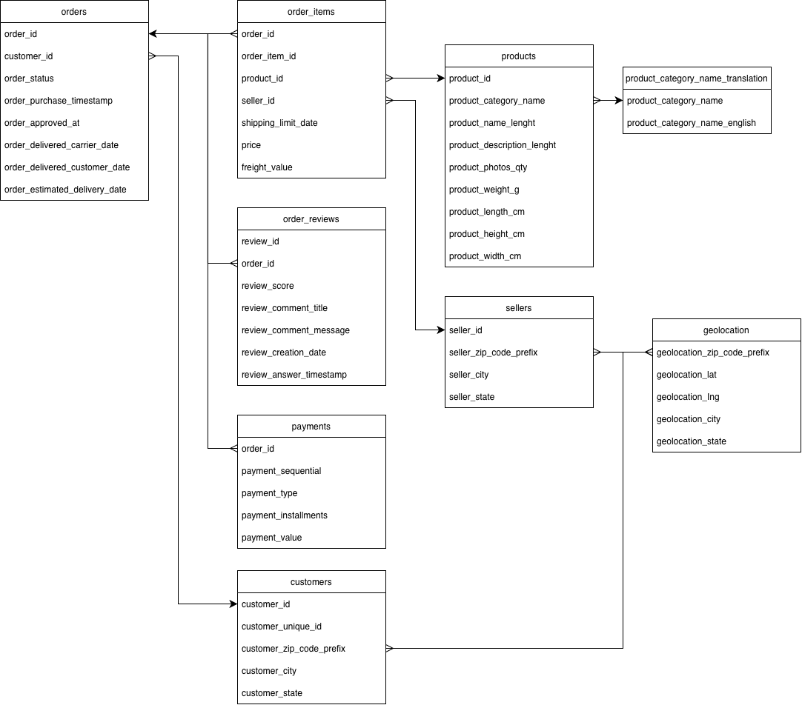
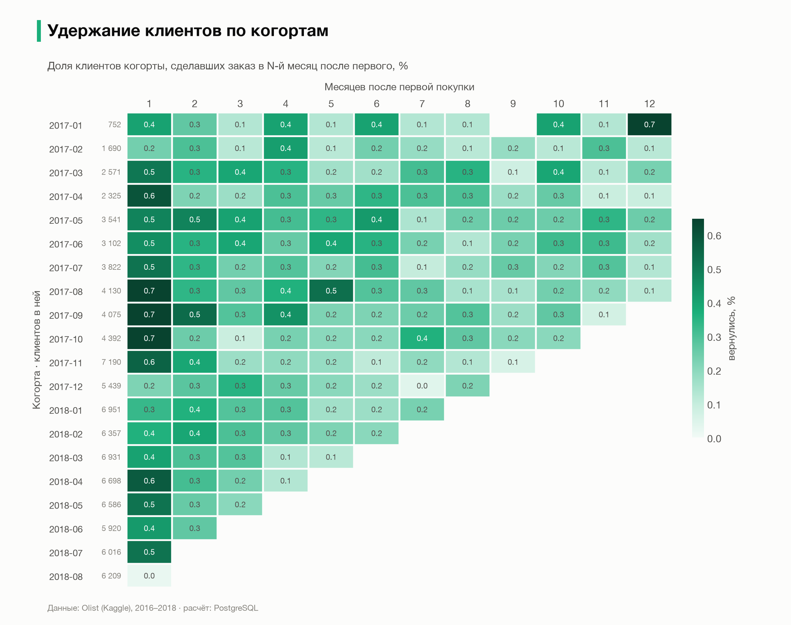
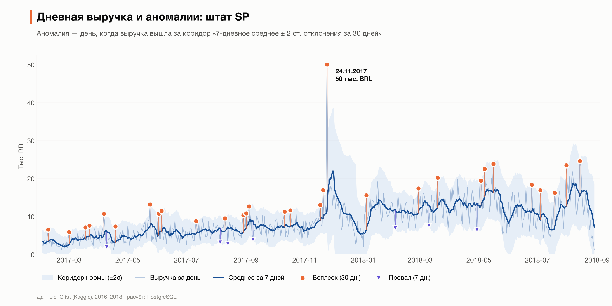
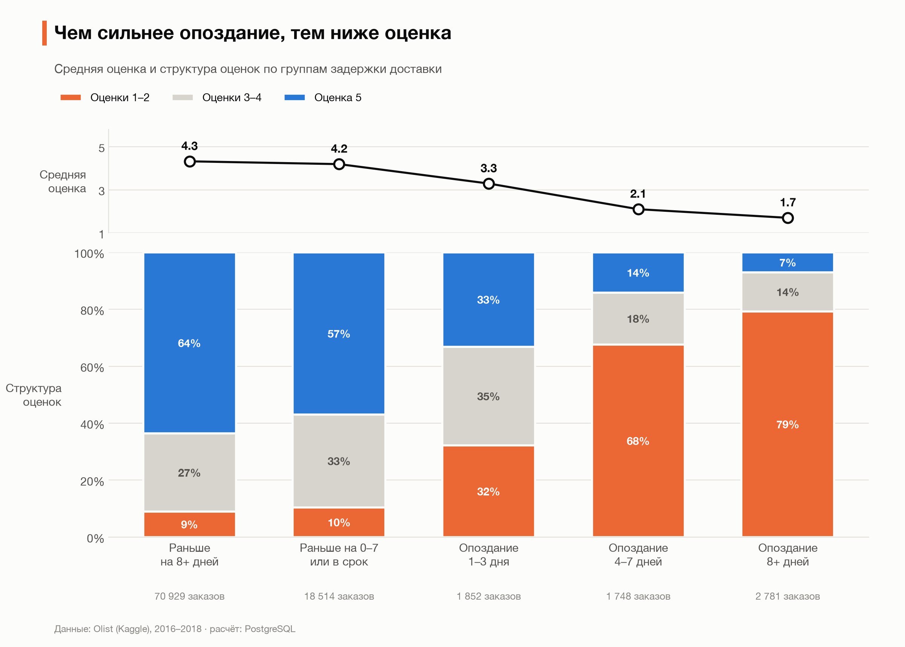
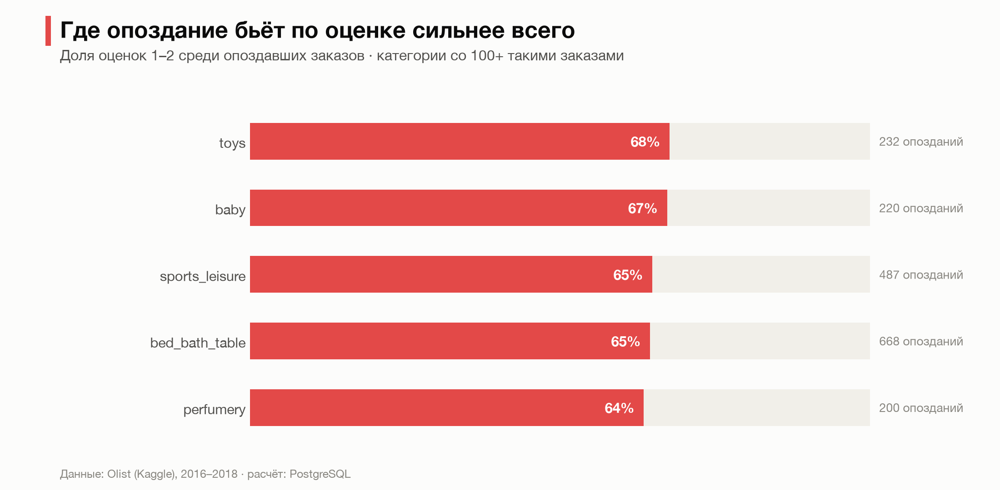
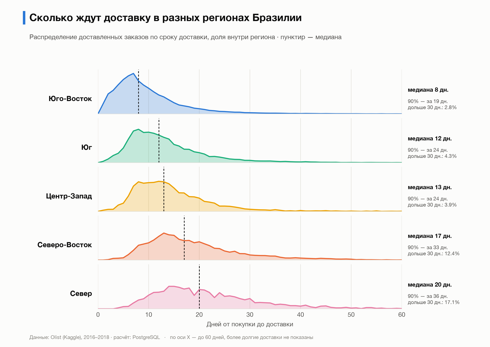
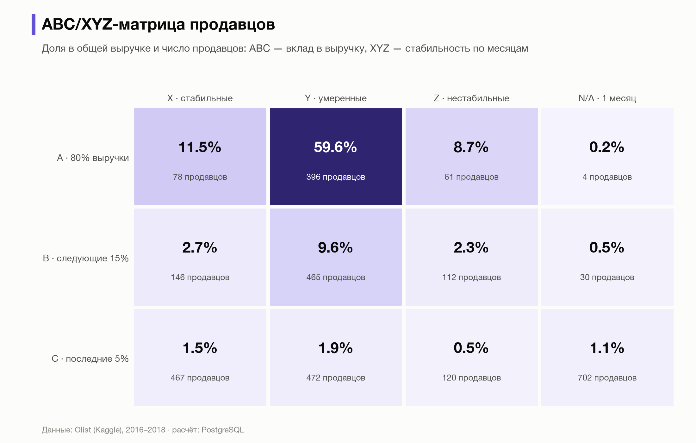
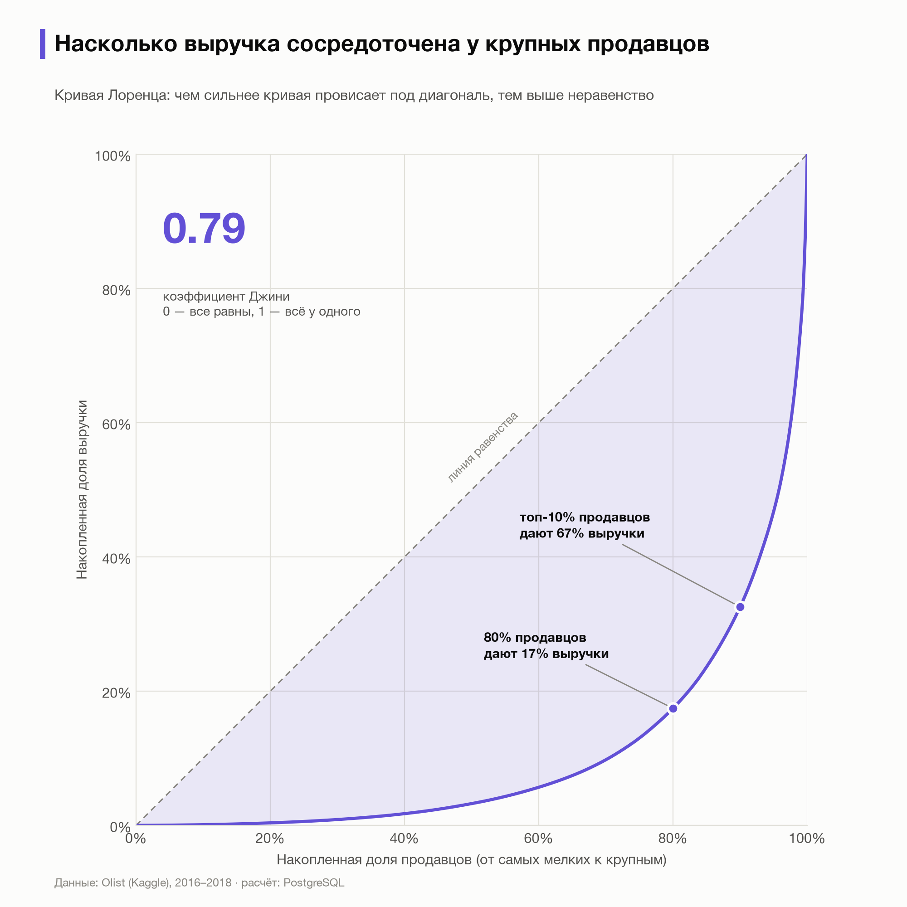
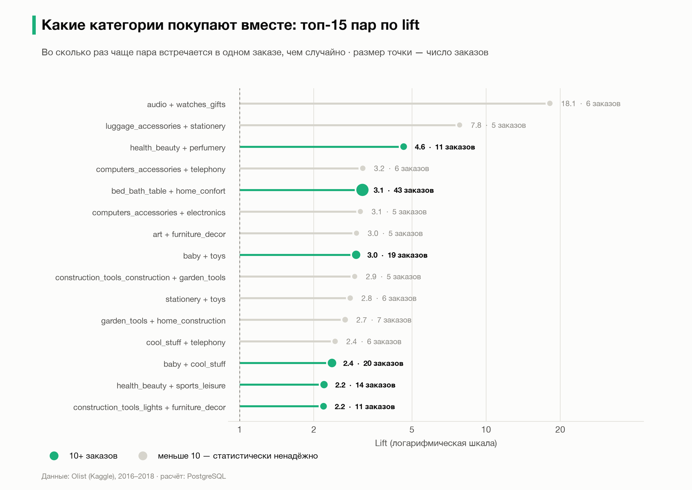

# Анализ маркетплейса Olist на SQL

Учебный проект по анализу данных бразильского маркетплейса Olist: пять аналитических задач на PostgreSQL и визуализация результатов в Python.

**Инструменты:** PostgreSQL, pgAdmin, Python (pandas, matplotlib, SQLAlchemy)

**Данные:** [Brazilian E-Commerce Public Dataset by Olist](https://www.kaggle.com/datasets/olistbr/brazilian-ecommerce) — около 100 тыс. заказов за 2016–2018 годы.

---

## Структура репозитория

```
├── README.md
├── requirements.txt    — зависимости Python
├── sql/                — SQL-запросы по каждой задаче
│   └── setup/          — схема БД и материализованные представления
├── docs/               — пошаговый разбор каждого SQL-запроса
├── python/
│   └── charts.py       — построение графиков
├── results/            — результаты запросов (csv)
└── images/             — ER-диаграмма
    └── charts/         — графики
```

## Схема данных



Основные таблицы: `orders`, `order_items`, `customers`, `sellers`, `products`, `order_reviews`, `payments`, `product_category_name_translation`.

Во всех задачах исключены заказы со статусами `canceled` и `unavailable`.

---

## 1. Когортный анализ удержания клиентов

**Вопрос:** какая доля клиентов возвращается за повторной покупкой в течение года после первого заказа?

**Подход:** клиент определяется по `customer_unique_id`, когорта — календарный месяц первого заказа. Для каждой когорты считается доля клиентов, сделавших заказ через 1, 2, …, 12 месяцев.

**Выводы:**
- Удержание очень низкое: в большинстве когорт в любой месяц возвращается менее 0.5% клиентов. Основная часть покупателей совершает один заказ.
- Когорты 2016 года и конца 2018 года малочисленны, их значения шумные.

📄 [SQL](sql/cohort_retention.sql) · [Разбор запроса](docs/cohort_retention.md)



---

## 2. Аномалии дневной выручки

**Вопрос:** в какие дни выручка резко отклонялась от обычного уровня?

**Подход:** для каждого дня считается скользящее среднее выручки за предыдущие 7 дней и стандартное отклонение за предыдущие 30 дней (текущий день в окно не входит). Аномалия — отклонение больше 2 стандартных отклонений. Дни без заказов заполнены нулями через `generate_series`. Анализ сделан по каждому штату и по Бразилии в целом.

**Выводы:**
- Самый сильный всплеск — 24.11.2017 (Черная пятница): в штате SP дневная выручка достигла около 50 тыс. BRL при обычном уровне 5-15 тыс. BRL.
- В малых штатах (RR, AC, AP) заказов мало, поэтому аномалий много и они малоинформативны; показательнее крупные штаты — SP, RJ, MG.

📄 [SQL](sql/revenue_anomalies.sql) · [Разбор запроса](docs/revenue_anomalies.md)



---

## 3. Влияние задержки доставки на оценку

**Вопрос:** как опоздание доставки связано с оценкой заказа и в каких категориях опоздания вредят сильнее всего?

**Подход:** задержка = дата фактической доставки − обещанная дата (в днях). Заказы разбиты на 5 групп: от «раньше срока более чем на 7 дней» до «опоздание более 7 дней». На заказ берётся один последний отзыв. Для категорий учтены только категории со 100+ опоздавшими заказами. Дополнительно построено распределение срока доставки (дни от покупки до доставки) по пяти регионам Бразилии — в долях внутри региона, чтобы сравнивать форму распределений, а не объёмы.

**Выводы:**
- Связь задержки и оценки отрицательная и нелинейная: при доставке в срок средняя оценка около 3.3, при опоздании более чем на неделю — около 1.7.
- Доля оценок 1–2 растёт с 9% у вовремя доставленных заказов до 79% при опоздании более недели.
- Ранняя доставка почти не повышает оценку по сравнению с доставкой в срок: клиенту важно получить заказ не позже обещанного.
- Категории с наибольшей долей низких оценок при опоздании указаны во второй таблицы ниже.

📄 [SQL](sql/delivery_and_score.sql) · [Разбор запроса](docs/delivery_and_score.md) · [SQL: распределение сроков доставки](sql/delivery_time_dest.sql) · [Разбор запроса](docs/delivery_time_dest.md)





---

## 4. ABC/XYZ-анализ продавцов

**Вопрос:** какие продавцы приносят основную выручку и насколько стабильны их продажи?

**Подход:**
- ABC — по накопленной доле выручки: A — первые 80%, B — следующие 15%, C — последние 5%.
- XYZ — по коэффициенту вариации месячной выручки (std / mean): X < 0,5, Y 0,5–1, Z > 1. Продавцы с продажами только в одном месяце выделены в отдельную группу N/A.
- Концентрация выручки дополнительно показана кривой Лоренца: продавцы упорядочены от мелких к крупным, по осям — накопленные доли продавцов и выручки; по ней считается коэффициент Джини.

**Выводы:**
- 539 продавцов из 3053 (около 18%, класс A) приносят 80% выручки; 1761 продавец (58%, класс C) - лишь 5%.
- Ядро маркетплейса - группа AY: 396 продавцов дают почти 60% всей выручки. Это крупные продавцы с умеренными колебаниями продаж от месяца к месяцу.
- Ключевых и стабильных продавцов (AX) всего 78 (2,6% от всех), они дают 11,5% выручки - их стоит удерживать в первую очередь.
- 61 крупный продавец (AZ) нестабилен: 8,7% выручки при сильных колебаниях, это зона риска для выручки.
- Почти четверть продавцов (736) продавала только в одном месяце (N/A), 702 из них - в классе C: длинный хвост разовых продавцов.
- 467 продавцов CX формально «стабильны», но это следствие метода: коэффициент вариации считается только по месяцам с продажами, поэтому продавец с парой похожих продаж за весь период тоже попадает в X.

📄 [SQL](sql/abc_xyz.sql) · [Разбор запроса](docs/abc_xyz.md) · [SQL: кривая Лоренца](sql/lorenz_dest.sql) · [Разбор запроса](docs/lorenz_dest.md)




---

## 5. Анализ корзины: какие категории покупают вместе

**Вопрос:** какие категории товаров покупают в одном заказе чаще, чем случайно, и как такие заказы оплачивают?

**Подход:** self-join таблицы «заказ — категория» по `order_id`, расчёт support, confidence и lift. Для топ-10 пар по lift — самый частый способ оплаты и среднее число рассрочек (по основному платежу заказа).

**Выводы:**
- Только около 1% заказов содержат товары из 2+ категорий (около 725 заказов). Среди всех заказов lift почти всех пар меньше 1, поэтому метрики посчитаны внутри мультикатегорийных заказов.
- Самая устойчивая связь: `bed_bath_table + home_confort` — 43 заказа, lift 3,15; в 86% таких заказов с `home_confort` есть и `bed_bath_table`.
- Самая частая пара `bed_bath_table + furniture_decor` (70 заказов) имеет lift всего 1,26 — это эффект популярности категорий, а не особая связь.
- Устойчивые тематические связки: `baby + toys`, `baby + cool_stuff`, `health_beauty + perfumery`.
- Пары с максимальным lift (`audio + watches_gifts`, lift 18) основаны на 5–6 заказах и статистически ненадёжны.
- Основной способ оплаты во всех топ-10 парах — кредитная карта; среднее число рассрочек от 1,8 до 5,8.

📄 [SQL](sql/products_pairs.sql) · [Разбор запроса](docs/products_pairs.md)



---

## Подводные камни, которые пришлось учесть

- **Задвоение метрик.** В заказе может быть несколько товаров и несколько отзывов: при джойнах оценки и заказы размножаются. Решение — один последний отзыв на заказ (`ROW_NUMBER`) и `DISTINCT` по паре «заказ — категория».
- **Даты против таймстемпов.** Обещанная дата доставки хранится как полночь, поэтому сравнение таймстемпов относило доставленные в срок заказы к опоздавшим. Задержка считается по датам.
- **Календарные месяцы в когортах.** Разница через `AGE` даёт прошедшие месяцы, а не календарные, и смещает повторные покупки в нулевой месяц.
- **Пропущенные дни.** Без заполнения нулями окно «7 строк» превращается в «7 дней с продажами», что искажает скользящее среднее.
- **Несколько платежей на заказ.** Для способа оплаты и рассрочки берётся основной платёж (с наибольшей суммой).
- **Неподходящая метрика.** Из-за редкости мультикатегорийных заказов lift на всех заказах почти всегда < 1; постановка скорректирована.

## Производительность

В схему добавлены первичные и внешние ключи, ограничения NOT NULL и CHECK, а также индексы ([схема](sql/setup/schema.sql)).
Замеры — `EXPLAIN (ANALYZE, BUFFERS)`, медиана 3–7 запусков, PostgreSQL на MacBook Air, `work_mem = 64MB`.

| Задача | Время |
|---|---|
| Когортный анализ | 232 мс |
| Аномалии выручки | 255 мс |
| Доставка и оценки — по группам задержки | 130 мс |
| Доставка и оценки — категории | 84 мс |
| ABC/XYZ | 158 мс |
| Анализ корзины — пары | 93 мс |
| Анализ корзины — оплата топ-10 | 93 мс |

**Что не удалось ускорить**

- **ABC/XYZ и аномалии выручки** агрегируют все позиции всех заказов. Запросу нужно почти 100% строк, поэтому PostgreSQL читает таблицы целиком (Seq Scan): индекс тут медленнее полного чтения. Время определяется объёмом данных, а не устройством запроса.
- **Фильтр по статусу** (`NOT IN ('canceled', 'unavailable')`) отсекает около 1% заказов, поэтому индекс по статусу бесполезен.
- **Индекс по отзывам** работает как Index Only Scan (без обращения к таблице) только после `VACUUM`: он заполняет карту видимости. Сразу после загрузки данных запрос медленнее.

## Ограничения

- Данные за 2016 год и конец 2018 года неполные.
- В малых штатах и малых когортах значения шумные.
- В анализе корзины выборки по парам маленькие (5–70 заказов), выводы ориентировочные.
